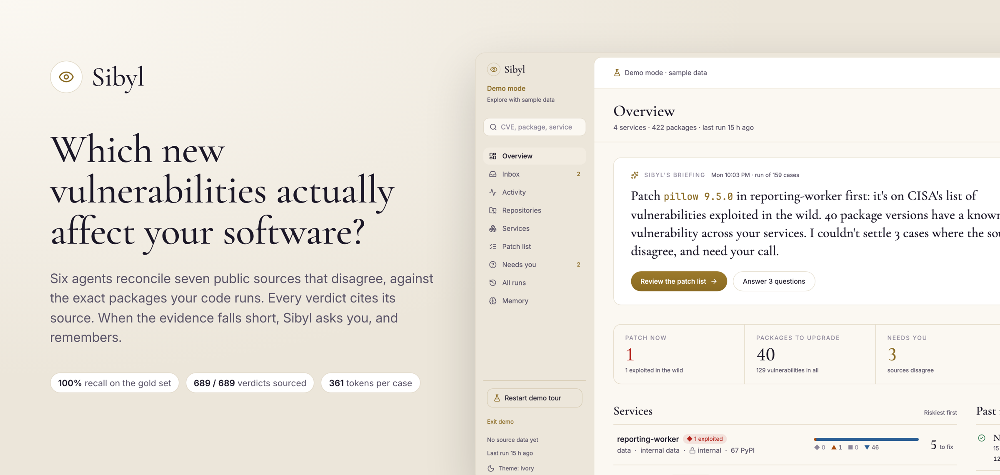
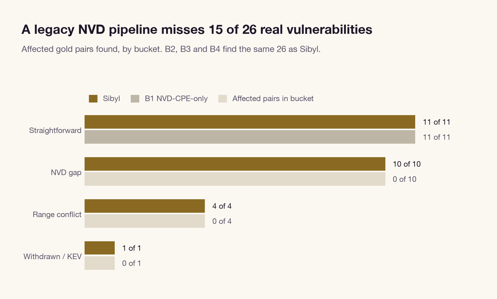
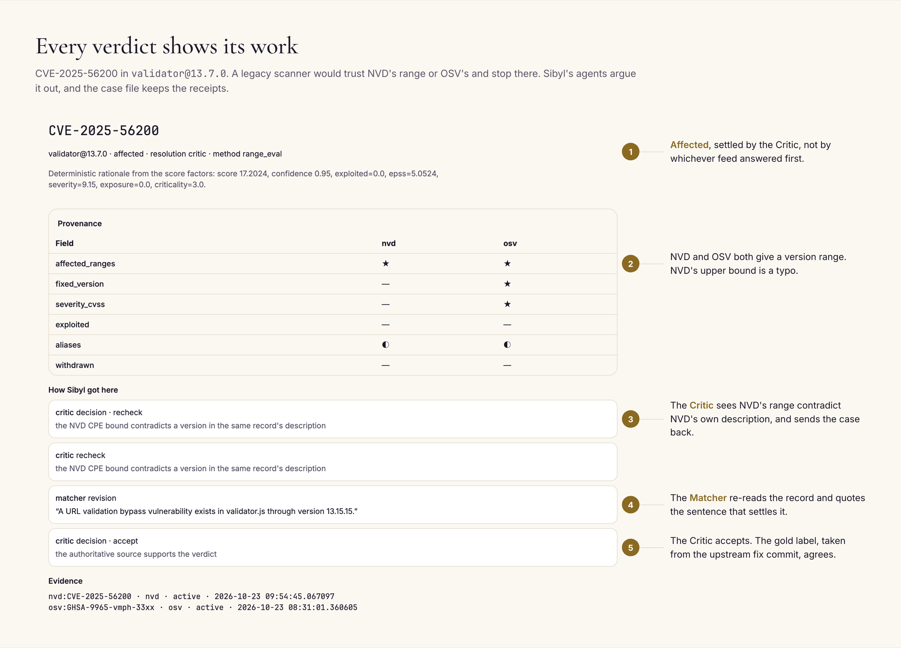
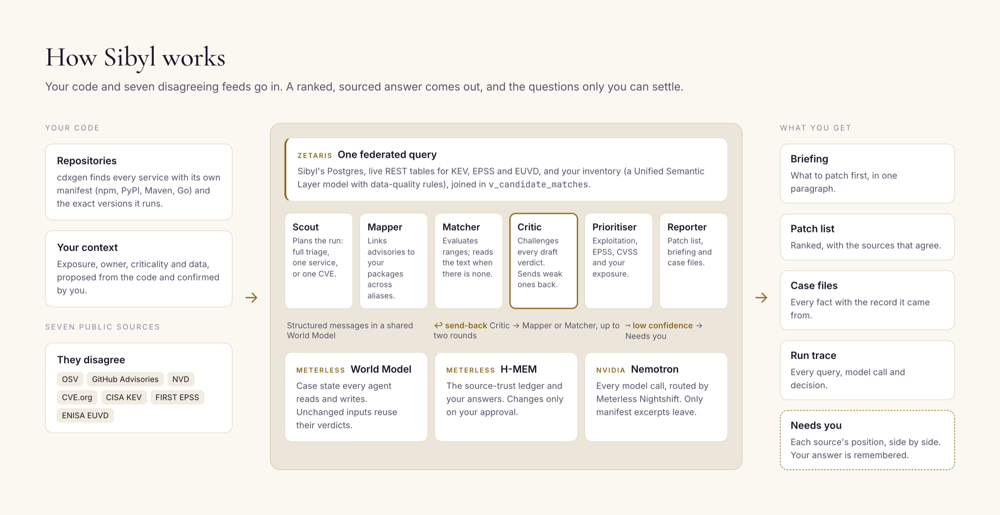
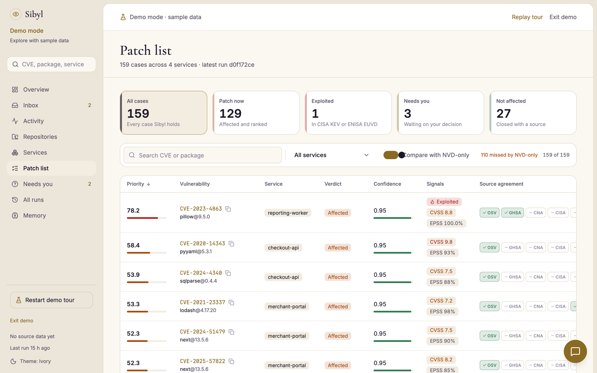
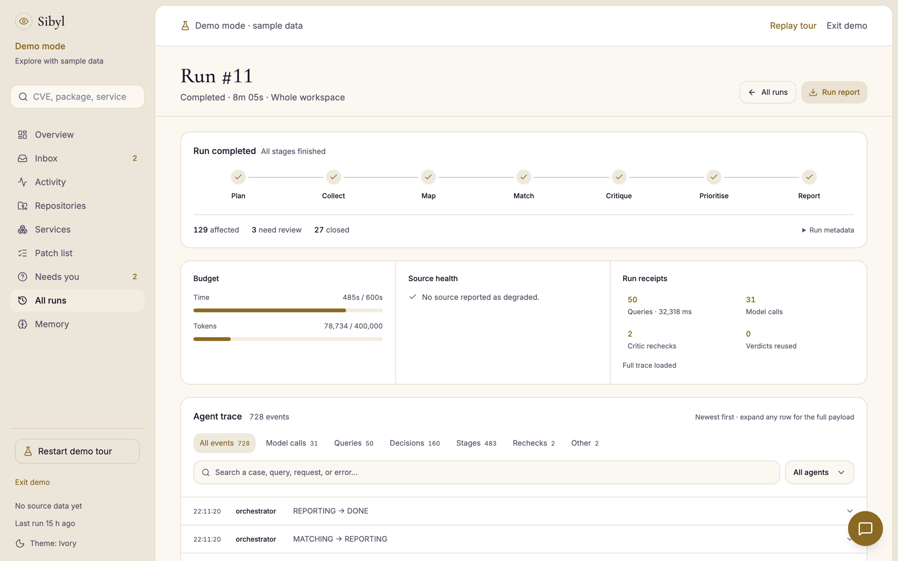
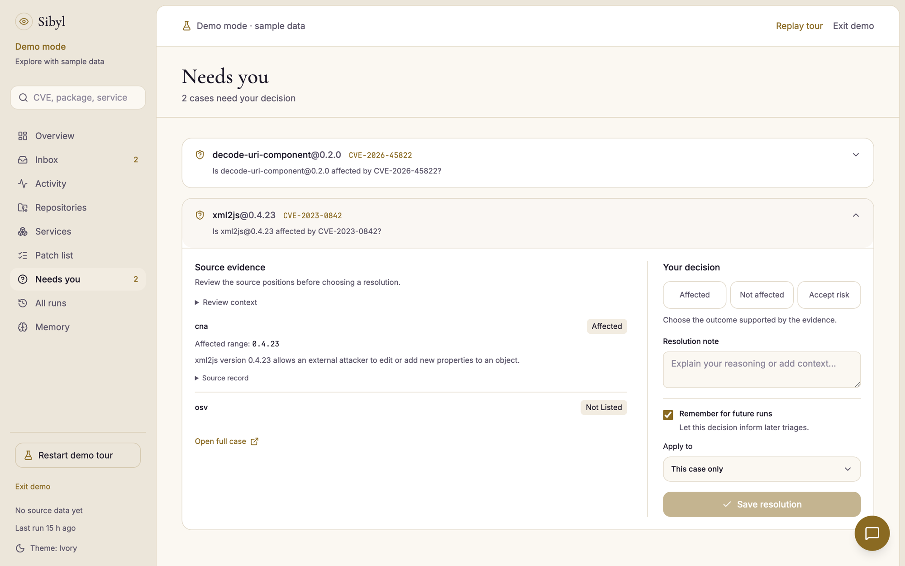
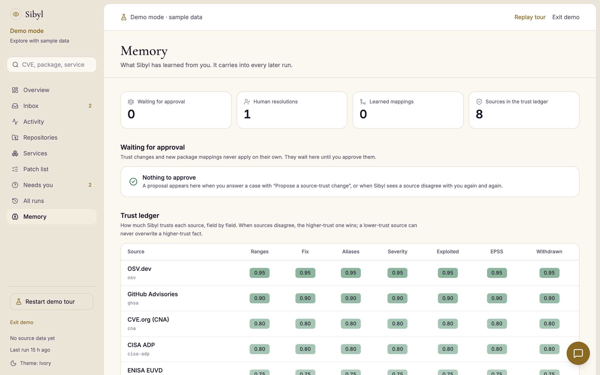
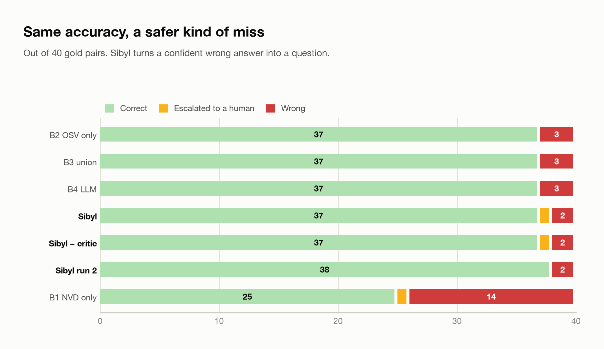

<picture>
  <source media="(prefers-color-scheme: dark)" srcset="assets/readme/dark/hero.png">
  
</picture>

# Sibyl

**Which new vulnerabilities actually affect your software?**

Sibyl is a team of six agents that answers that question for your own code, and shows its work. Connect a repository and Sibyl finds every service and the exact package versions it runs. It reconciles seven public vulnerability sources that disagree with each other, and tells you what to patch first. Every verdict cites the record behind it. When the evidence falls short, Sibyl asks you instead of guessing, and it remembers your answer.

★ Built for the Open Agent Hackathon 2026, Track 1: Solving Fragmented Intelligence.

## Your scanner went quiet in April

On 15 April 2026, NIST's National Vulnerability Database (NVD) stopped fully enriching most new CVEs. Only 15 to 20 percent still get the CPE data that tells a scanner which product versions are affected. Many free scanners and in-house scripts match your software to vulnerabilities through exactly that data. Since April they have been missing new vulnerabilities, and they do it silently: no error, just fewer findings.

The data still exists, but it is spread across seven sources that disagree. OSV, GitHub Advisories, NVD, CVE.org, CISA KEV, FIRST EPSS and ENISA EUVD each describe the same flaw with different package names, different version ranges, and sometimes plain mistakes. When we checked the twelve newest reviewed GitHub advisories, NVD had no CPE data for any of them. OSV and GitHub had exact version ranges for all twelve.

So a security engineer reads four advisories to settle one CVE, for one package, in one service. Then they do it again next week.

<picture>
  <source media="(prefers-color-scheme: dark)" srcset="eval/results/charts/dark/01-problem-recall-by-bucket.png">
  
</picture>

On our hand-labelled gold set, a pipeline built on NVD alone finds 11 of the 26 real vulnerabilities. Sibyl finds all 26.

## What Sibyl promises

- **It starts from your code.** Not a list of CVEs, but the services you run and the exact versions inside them.
- **It shows its work.** Every fact links to the source record it came from, and every disagreement shows which source won and why.
- **It asks when it can't know.** Thin or conflicting evidence goes to you with each source's position side by side. It is never guessed at.
- **It learns.** Your answer decides the same case in later runs. Trust in a source changes only when you approve it.

## Every verdict shows its work

<picture>
  <source media="(prefers-color-scheme: dark)" srcset="assets/readme/dark/case-file.png">
  
</picture>

Here is one real case from the sample run. NVD's version range for `validator` is a typo that contradicts NVD's own description. A scanner that trusts one feed would take the range at face value. Sibyl's Critic notices the contradiction and sends the case back. The Matcher re-reads the record and quotes the sentence that settles it, and the Critic accepts. The gold label, taken from the upstream fix commit, agrees.

This is the core idea: agents that check each other's work, and a case file that keeps the receipts.

## How Sibyl works

<picture>
  <source media="(prefers-color-scheme: dark)" srcset="assets/readme/dark/how-it-works.png">
  
</picture>

| Agent | What it does |
|---|---|
| **Scout** | Plans the run from the request: a full triage, one service, or a single CVE question. |
| **Mapper** | Links advisories to your packages, across aliases and naming schemes. |
| **Matcher** | Evaluates version ranges, and reads the advisory text when there is no structured range. |
| **Critic** | Challenges each draft verdict: source authority, disagreements, withdrawn records, unsupported quotes. Sends weak cases back to the Mapper or Matcher. |
| **Prioritiser** | Scores what is affected with exploitation, EPSS, CVSS and your service's exposure, and routes low-confidence cases to you. |
| **Reporter** | Writes the briefing, the patch list and the case files. |

The agents talk through structured messages in a shared World Model, so every claim, conflict and send-back is traceable.

## A week with Sibyl

1. **Connect a repository.** Sibyl scans the tree with `cdxgen` and makes a service of every folder with its own manifest (npm, PyPI, Maven, Go), with the exact versions it runs.
2. **Confirm what it worked out.** From the code, Sibyl proposes each service's exposure, owner, criticality and data, and asks you to confirm them in the Inbox. Those answers weight every priority after that.
3. **Let the agents triage.** Six agents reconcile the seven sources against your packages. The run page shows each stage, the budget, every Zetaris query and model call, and every Critic send-back.
4. **Read the briefing.** One paragraph tells you what to patch first and which decisions are waiting on you.
5. **Patch what matters.** The patch list ranks cases by known exploitation, EPSS, CVSS and how exposed the service is, and shows which sources agree. Turn on **Compare with NVD-only** to see what a legacy scanner would have missed: on the sample company, 110 cases.
6. **Answer what it can't settle.** Conflicting or thin evidence lands in *Needs you*, with each source's position side by side.
7. **It remembers, and keeps watching.** Your answer decides the same case next time. Sibyl re-scans when code changes, refreshes the feeds and re-triages on a schedule, reusing every verdict whose inputs didn't change.

<table>
  <tr>
    <td width="50%">
      <picture>
        <source media="(prefers-color-scheme: dark)" srcset="assets/readme/dark/patch-list.png">
        
      </picture>
      <p><b>Patch list.</b> Ranked, with the sources that agree, and what an NVD-only scanner would miss.</p>
    </td>
    <td width="50%">
      <picture>
        <source media="(prefers-color-scheme: dark)" srcset="assets/readme/dark/run-trace.png">
        
      </picture>
      <p><b>Run trace.</b> Every stage, query, model call and decision, recorded.</p>
    </td>
  </tr>
  <tr>
    <td width="50%">
      <picture>
        <source media="(prefers-color-scheme: dark)" srcset="assets/readme/dark/needs-you.png">
        
      </picture>
      <p><b>Needs you.</b> When sources disagree, you make the call, and Sibyl remembers it.</p>
    </td>
    <td width="50%">
      <picture>
        <source media="(prefers-color-scheme: dark)" srcset="assets/readme/dark/memory.png">
        
      </picture>
      <p><b>Memory.</b> The trust ledger and your answers. Nothing changes without your approval.</p>
    </td>
  </tr>
</table>

You can try all of this without a repository: press **Explore the demo** for a ten-step guided tour of a sample company with four services.

## Does it work?

Measured on the full sample run (4 services, 689 cases) against 40 hand-labelled gold pairs. Each label comes from the upstream fix commit, never from Sibyl's output.

| | Sibyl |
|---|---|
| Recall: real vulnerabilities found | **100%** (26 of 26) |
| Precision | **92.9%** |
| Accuracy | **92.5%** |
| Verdicts that cite a source record | **689 of 689** |
| Tokens per case | **361** |
| Re-run of an unchanged repository | **69 of 69** verdicts reused, zero model calls |

<picture>
  <source media="(prefers-color-scheme: dark)" srcset="eval/results/charts/dark/06-how-each-system-is-wrong.png">
  
</picture>

Sibyl matches the best baseline on accuracy with fewer false alarms (2, against 3 for OSV alone), because the one pair it can't settle goes to a human instead of being guessed. A pipeline built on NVD alone misses 15 of the 26 real vulnerabilities. And unlike any single feed, every Sibyl verdict comes with its sources, its conflicts and a priority.

Sibyl is also built to fail safe. With any one of the seven sources switched off, the run still finishes and is marked degraded. With OSV down, Sibyl sends 18 cases to a human instead of 3: it gets more careful, not wrong. Instructions planted in an advisory are quarantined before they reach a model.

Every number is reproducible. [`eval/README.md`](eval/README.md) explains how, and the full tables and charts are in [`eval/results/`](eval/results/).

## Built on

- **Zetaris** is the data layer. It federates Sibyl's Postgres with live REST tables for KEV, EPSS and EUVD, and joins them with your inventory in one query, `v_candidate_matches`. The inventory is a Zetaris Unified Semantic Layer model with data-quality rules that run after every sync.
- **Meterless** provides the World Model, which holds case state, and H-MEM, which holds the trust ledger and your resolutions. Both are our own TypeScript implementations in `engines/`; they pass the upstream conformance suites 8/8 and 13/13. Nightshift routes every model call.
- **NVIDIA Nemotron** answers every model call, through a Nemotron-only fleet in Nightshift. Only manifest excerpts are sent, never whole files.
- Python 3.12, FastAPI, Postgres 16, and React with Vite, Tailwind and shadcn/ui.

## Run it

You need Python 3.12 with [uv](https://docs.astral.sh/uv/), Node 20 or later, Docker, a running Zetaris and Meterless Nightshift.

```text
uv sync
npm --prefix engines install
npm --prefix web install
docker compose up -d          # Postgres 16 on localhost:5434
cp .env.example .env          # then fill in the Zetaris and Nightshift values
uv run scripts/setup.py       # build engines, seed Postgres, ingest the sample, register it in Zetaris
uv run tests/smoke_test.py    # checks Zetaris and a Nemotron reply
scripts/dev.sh                # API on :8000, UI on http://localhost:5173
```

- **Zetaris** runs from its own Docker bundle. Put its REST URL, org id and API key in `.env`. Its query engine reaches Postgres at `host.docker.internal:5434`; set `ZETARIS_PG_HOST` and `ZETARIS_PG_PORT` if yours is reached another way.
- **Meterless Nightshift** is the desktop app. Create a Sibyl fleet under NIGHT → LANES with Nemotron lanes only (Nemotron 3.5 Lightning and Nemotron 3 Nano to race, Nemotron 3.5 Super VL to judge, Nemotron 3 Ultra to verify), then copy the runtime token into `METERLESS_RUNTIME_TOKEN`. The NVIDIA key stays in Nightshift.
- For live repositories, `GITHUB_TOKEN` (private repos, higher GitHub Advisories limits) and `NVD_API_KEY` are optional. `SIBYL_SCHEDULER=false` turns off scheduled syncs and triages.

Then open the UI and either connect a repository or press **Explore the demo**.

### More commands

```text
uv run scripts/run_demo.py --label fixtures      # headless triage; report and trace in output_examples/
uv run pytest                                    # unit tests
uv run tests/robustness_check.py                 # one outage per source, plus idempotency
uv run eval/collect_runs.py && uv run eval/run_eval.py   # re-run the eval
uv run --with matplotlib eval/charts.py          # redraw the result charts
```

## What's in the repo

| Path | |
|---|---|
| `sibyl/` | Agents, orchestrator, job queue and scheduler, API |
| `engines/` | World Model and H-MEM engines (TypeScript) |
| `web/` | The UI |
| `zetaris/sql/` | Zetaris datasources, REST tables and views |
| `prompts/` | Versioned agent prompts |
| `output_examples/` | Example reports, full agent traces and UI screenshots |
| `eval/` | Gold set, eval harness and results |
| `data/sample/` | The sample company's SBOMs and source snapshots |
| `assets/readme/` | Images for this README |
