# Sibyl

An agent team that tells a security engineer which new vulnerabilities actually affect their software. Connect a repository: Sibyl finds the services and their dependencies, asks you to confirm what it works out about each service, reconciles seven public vulnerability sources against them, keeps a source on every fact, and escalates uncertainty to a human.

This repository is the Open Agent Hackathon 2026 build. Planning lives in a local `docs/` folder that is not part of the git history.

## Results

**Sibyl is as accurate as the best single feed, and better in four ways: it is more precise, it uses 53× fewer tokens than an LLM call per case, it cites a source for every verdict, and it improves once a human answers it.**

Every number below is from the full sample workspace (4 services, 689 cases) scored against 40 hand-labelled gold pairs. The tables are in [`eval/results/eval-full.md`](eval/results/eval-full.md) and [`eval/results/robustness.md`](eval/results/robustness.md), and [`eval/README.md`](eval/README.md) shows how to reproduce them.

### The problem: a legacy NVD pipeline misses more than half

NVD stopped enriching most new CVEs with CPE data in 2026. A pipeline that matches only on NVD CPEs (B1) finds 11 of the 26 real vulnerabilities in the sample services' SBOMs. It finds none of the 10 NVD-gap pairs, and none of the 4 range conflicts where NVD is wrong.

<picture>
  <source media="(prefers-color-scheme: dark)" srcset="eval/results/charts/dark/01-problem-recall-by-bucket.png">
  
</picture>

### Why the test can be trusted

The 40 gold pairs come from the sample SBOMs and real advisories. Each one is labelled from the upstream fix commit and the first tag that contains it, and sometimes from the code at the installed tag, never from Sibyl's output. The pairs were picked by a script that sees only what the sources said, frozen before any tuning, and reviewed by a human. Three pairs were swapped out, with the reasons recorded: one that upstream could not settle, and two whose label would have contradicted every source.

<picture>
  <source media="(prefers-color-scheme: dark)" srcset="eval/results/charts/dark/02-gold-set.png">
  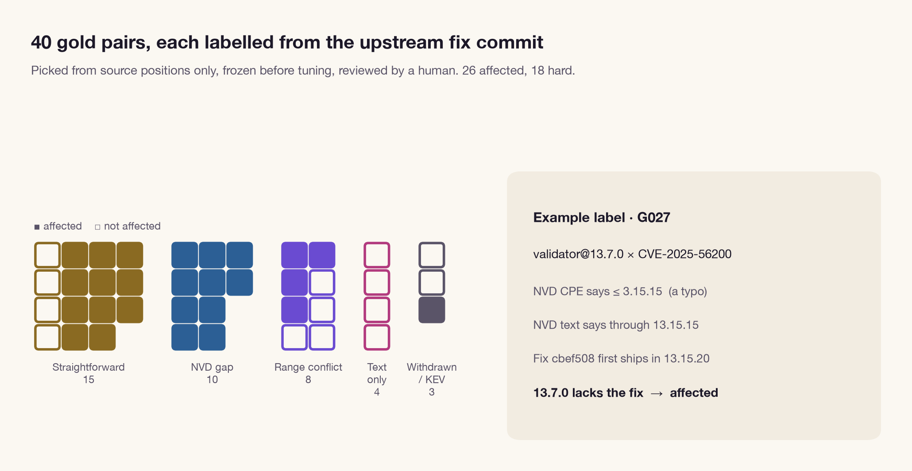
</picture>

### What Sibyl does better

<picture>
  <source media="(prefers-color-scheme: dark)" srcset="eval/results/charts/dark/03-wins.png">
  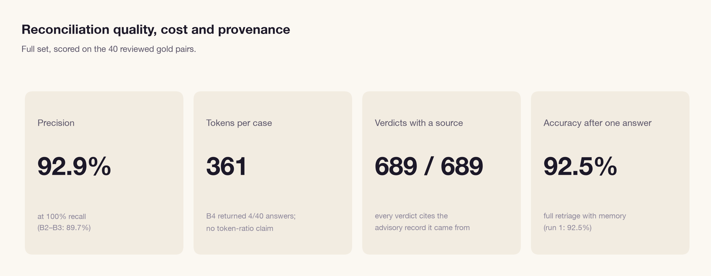
</picture>

| | Sibyl | Best baseline |
|---|---|---|
| Precision | **92.9%** | 89.7% (B2 OSV-only, B3 naive union, B4 single-pass LLM) |
| False positives | **2** | 3 |
| Wrong-confident rate (confidence ≥ 0.8) | **5.7%** of 35 | 7.5% of 40 (B4) |
| Tokens per case | **365** | 19,264 (B4) |
| Seconds per case | **0.83** | 9.2 (B4) |
| Accuracy after one human resolution (run 2) | **95.0%** | 92.5% |
| Verdicts that cite a source record | **689 of 689** | not produced |

Each row of the grid below is a gold pair. On braces, an advisory GitHub withdrew as not practically exploitable, every baseline confidently says affected. Sibyl asks a human instead, and run 2 gets it right from memory.

<picture>
  <source media="(prefers-color-scheme: dark)" srcset="eval/results/charts/dark/04-per-pair-grid.png">
  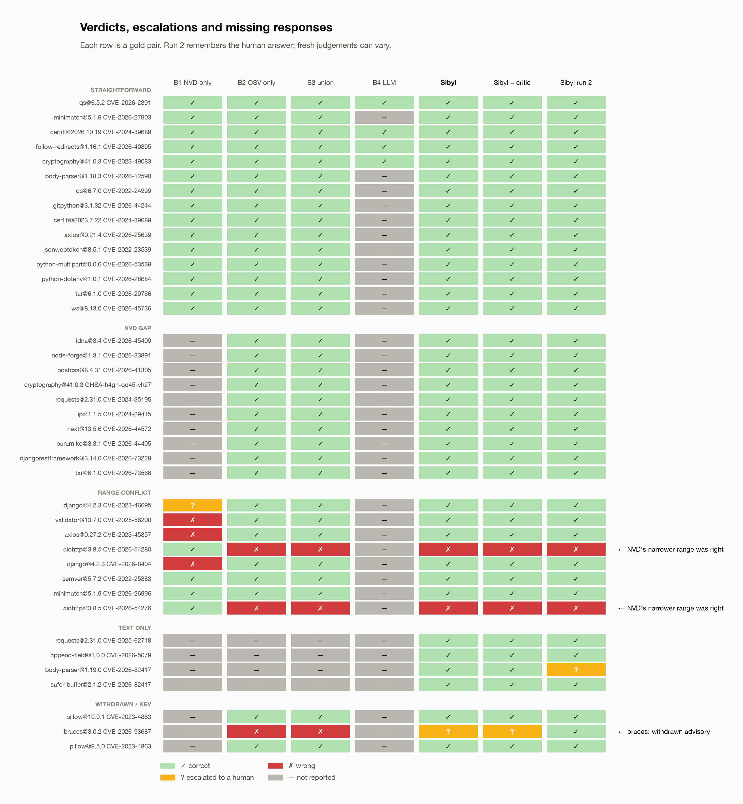
</picture>

B4 gives an LLM all the same evidence and asks once per case. It reaches the same accuracy, but costs 53 times more tokens. Sibyl calls the model only for advisory prose, critic send-backs and rationales.

<picture>
  <source media="(prefers-color-scheme: dark)" srcset="eval/results/charts/dark/05-cost-per-case.png">
  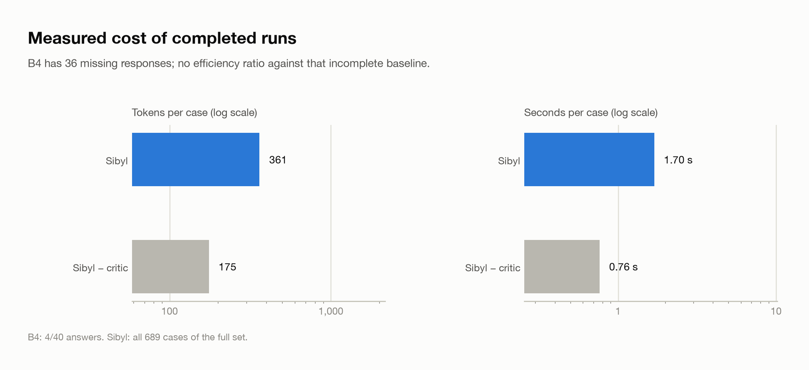
</picture>

### Where it ties: no trade-off

Sibyl finds all 26 affected pairs (100% recall), as do B2, B3 and B4, so its precision and cost come at no loss of coverage. Accuracy ties at 92.5% because Sibyl's one "miss" is braces, which it escalated rather than got wrong. An escalation counts as a miss for accuracy.

<picture>
  <source media="(prefers-color-scheme: dark)" srcset="eval/results/charts/dark/06-how-each-system-is-wrong.png">
  
</picture>

### Every answer shows its work

On validator@13.7.0 × CVE-2025-56200, NVD's CPE bound is a typo (≤ 3.15.15), while NVD's own description says "through version 13.15.15". The critic catches the contradiction and sends the case back. The Matcher re-reads the description and quotes it. The verdict stays affected and links to the fix commit. With the critic on, 6 of 9 gold conflicts are surfaced; without it, 4 of 9.

<picture>
  <source media="(prefers-color-scheme: dark)" srcset="eval/results/charts/dark/07-case-file-validator.png">
  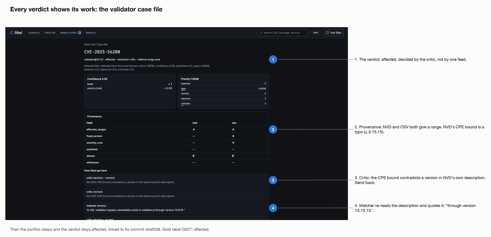
</picture>

<picture>
  <source media="(prefers-color-scheme: dark)" srcset="eval/results/charts/dark/10-critic-conflicts.png">
  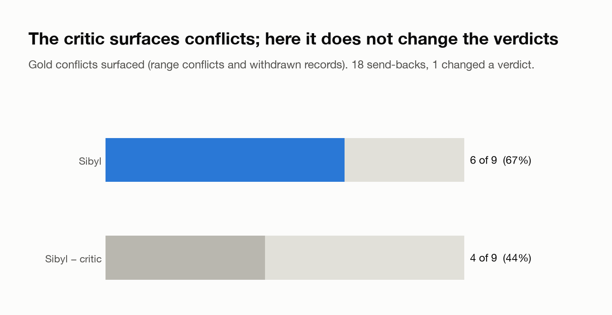
</picture>

### Answer once, and it remembers

The one run-1 needs-human gold pair was resolved and stored in H-MEM. In run 2, escalations fell from 6 to 5, LLM calls from 77 to 71, and tokens from 251k to 220k. Gold accuracy rose from 92.5% to 95.0%. It is a small effect from a single answer, and it compounds.

<picture>
  <source media="(prefers-color-scheme: dark)" srcset="eval/results/charts/dark/08-memory-effect.png">
  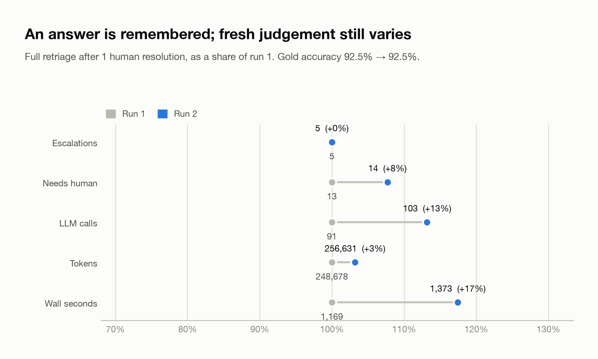
</picture>

### What it gets wrong, and why

- **Both wrong answers are aiohttp@3.8.5.** OSV marks every version affected, but NVD's narrower range (3.12 and later) is right. Sibyl never saw NVD's range: that CPE leaves the target-software field blank, so the row is filed under ecosystem `nvd` and never joins the PyPI component. The same gap explains all 3 missed conflicts and the 5.7% wrong-confident rate, which is just over the 5% target. B1 joins on the package name alone, which is why it got these two right.
- **B1 has 100% precision** because it rarely says affected: it misses 15 of the 26.
- **The critic does not change accuracy on this set.** OSV is right everywhere NVD is wrong, so source-trust order already picks the right verdict. Turning the critic off makes Sibyl cheaper (129 tokens per case) without changing a verdict. What the critic adds is conflict detection, the withdrawn-record check, quoted re-reads and the trail.
- **Sibyl takes about 9.5 minutes on 689 cases**, while B1–B3 are single queries. That is inside the default 10-minute run budget (`RUN_MAX_SECONDS=600`).
- **Some samples are small.** Calibrated escalation (100%) is 1 of 1 escalated gold pair, and the memory effect comes from a single resolution.

<picture>
  <source media="(prefers-color-scheme: dark)" srcset="eval/results/charts/dark/09-cpe-join-gap.png">
  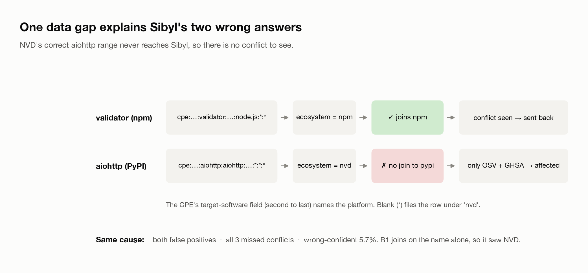
</picture>

### When a source goes down

With any one of the seven sources disabled, the run still finishes and the report is marked degraded. With OSV down, confidence drops on 142 cases and 18 cases go to a human instead of 3: Sibyl gets more careful, not wrong. Every source falls back to its snapshot after two retries on a 429, a 503 or a timeout. Instructions planted in an advisory description are quarantined and never reach the model. Re-ingesting the same snapshots changes nothing.

<picture>
  <source media="(prefers-color-scheme: dark)" srcset="eval/results/charts/dark/11-robustness-outages.png">
  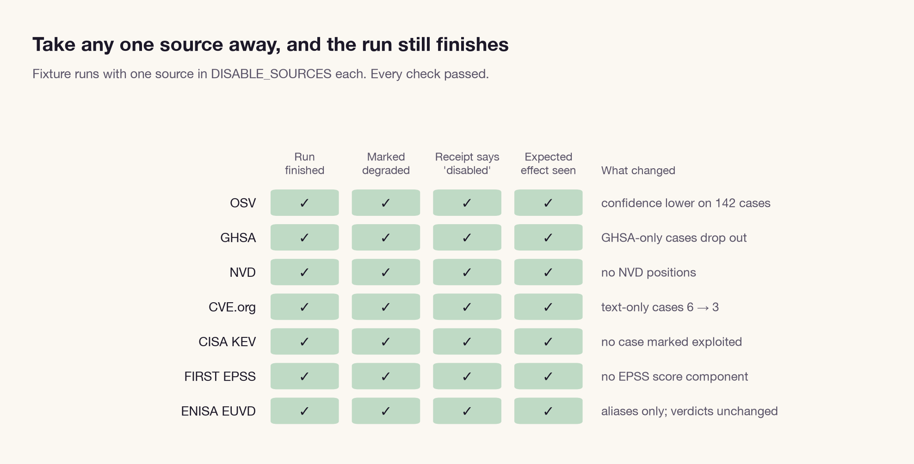
</picture>

<picture>
  <source media="(prefers-color-scheme: dark)" srcset="eval/results/charts/dark/12-robustness-osv-down.png">
  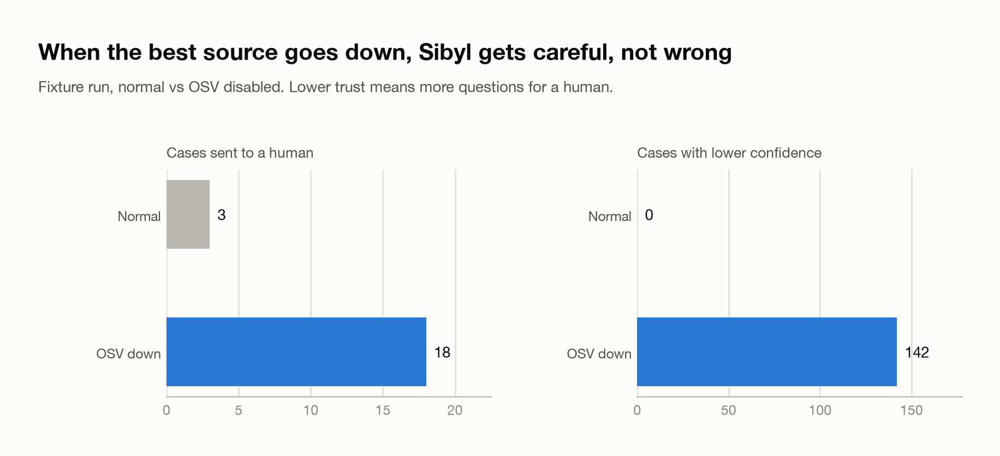
</picture>

<picture>
  <source media="(prefers-color-scheme: dark)" srcset="eval/results/charts/dark/13-robustness-defences.png">
  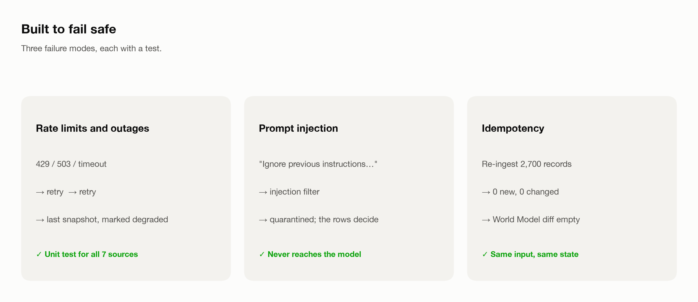
</picture>

## How it works

- **Data:** seven public sources (OSV, GitHub Advisories, NVD, CVE.org, CISA KEV, FIRST EPSS, ENISA EUVD) are ingested into Postgres. Zetaris joins them with the workspace's SBOMs and the KEV, EPSS and EUVD feeds in one query, `v_candidate_matches`.
- **Inventory:** connect a git URL or a local folder. The first sync runs `cdxgen` over the whole tree and makes a service of every directory with its own manifest (npm, PyPI, Maven, Go); later syncs read `git diff` and re-scan only what changed. A profiler proposes each service's exposure, owner, criticality and data class from the lines it read, and asks you to confirm. The inventory is a Zetaris Unified Semantic Layer model (`lightning.metastore.sibyl.inventory`) with data-quality rules that run after every sync.
- **Agents:**
  - Scout classifies the request.
  - Mapper maps sources to packages.
  - Matcher evaluates ranges, and reads prose for text-only advisories.
  - Critic checks authority, disagreement, withdrawn records and quotes, and sends cases back.
  - Prioritiser scores with KEV, EPSS, CVSS and exposure.
  - Reporter writes the report.
  - The models are Nemotron lanes through Meterless Nightshift.
- **State:** the Meterless World Model engine holds case state. The H-MEM engine holds the trust ledger and human resolutions. Both are TypeScript modules in `engines/`, checked by the upstream conformance runners.
- **UI:** a home page to connect a repository (the sample workspace is a "Try the demo" button), then repositories, services, an inbox of the agents' questions, run trace, patch list, case file, needs-human queue and memory, in React (`web/`).

## Stack

- Python 3.12 (uv), FastAPI, Postgres 16
- TypeScript engines for Meterless World Model and H-MEM (`engines/`), checked by the upstream conformance runners
- React, Vite, TypeScript, Tailwind, shadcn/ui

## Setup

```text
uv sync
docker compose up -d          # Postgres 16 on localhost:5434
cp .env.example .env          # then fill in Zetaris and Nightshift values locally
npm --prefix web install      # web/.npmrc sets legacy-peer-deps so npm 10 can resolve Vite 8
```

Zetaris runs from its own Docker bundle. Meterless Nightshift is the installed desktop app. The NVIDIA key stays in Nightshift, not in `.env`. `.env.example` points `SNAPSHOT_DIR` at the committed sample, `data/sample/snapshot-subset/`.

## Commands

```text
uv run tests/smoke_test.py                       # Zetaris web, Zetaris SQL, Nemotron reply
uv run scripts/seed_db.py                        # inventory and evidence schemas, plus the demo workspace
scripts/dev.sh                                   # Postgres, FastAPI on :8000, UI on :5173
uv run scripts/run_demo.py --label fixtures      # headless run; report and trace in output_examples/
uv run pytest                                    # unit tests
uv run eval/collect_runs.py                      # live eval runs (see eval/README.md)
uv run eval/run_eval.py                          # score them against the gold set
uv run tests/robustness_check.py                 # one outage per source, plus idempotency
uv run --with matplotlib eval/charts.py          # redraw the result charts
```

Engine conformance runs from a local checkout of [Meterless/Meterless](https://github.com/Meterless/Meterless), pointed at `engines/world-model/src/index.ts` and `engines/hmem/src/index.ts`. The outputs are in `eval/results/engines/`.

## Status

- Data layer, agents, engines, memory and UI are built.
- The gold-set eval and the robustness checks are recorded.
- Example reports and traces are in `output_examples/`.
- Still ahead: the clean-clone sample run, the receipts screen and the submission materials.
